# AIP Mode 1 Learning Plan

## Scope

- Learning root: `AIP/`
- KP root: `AIP/preRaw/KP/`
- KP count: 74
- Status snapshot: 3 `pending`; 0 `learning`; 0 `review`; 71 `completed`
- Completed and persisted: 71 / 74 (95.9%); derived from KP status.
- Route objective: learn every prepared KP one at a time in a dependency-valid, conceptually useful order.
- Last analysis date: 2026-10-31 (direct prerequisite and route revalidation)
- Last progress update: 2026-10-31

## Route Input Summary

format: semantic-sha256-v1

| KP ID | Path relative to learning root | SHA-256 |
|---|---|---|
| aip-agentic-actiongroups-022 | preRaw/KP/aip-agentic-actiongroups-022.md | 5aedca4d7c60b3a489d89e832f828a19e370583ad2bb436bad24fdeb5912a077 |
| aip-agentic-agentcore-024 | preRaw/KP/aip-agentic-agentcore-024.md | 87b81451c0e5c35291bb7f36c5de6c4ed2b1ba81fe5b3074eb5f998404dc79f9 |
| aip-agentic-mcp-026 | preRaw/KP/aip-agentic-mcp-026.md | 948ebb863a08983694be9996f914e526a78736dcf15abb0af77b3596fead0c69 |
| aip-agentic-memory-023 | preRaw/KP/aip-agentic-memory-023.md | cc16e501aa6952c81913d17e3fe25f6e17b607abd43c7f8baab1284c7c519403 |
| aip-agentic-multiagent-hitl-073 | preRaw/KP/aip-agentic-multiagent-hitl-073.md | 839f36913183b22ad02a95f595e8aa3dd308aae6983e8efd128c08c59e2637d0 |
| aip-agentic-planning-021 | preRaw/KP/aip-agentic-planning-021.md | 2ae402c79e3838d8a42ba2e7f60d6d131e044358cc6fbf29a1720c97786b1841 |
| aip-agentic-qapps-029 | preRaw/KP/aip-agentic-qapps-029.md | d51ba9c47bd97697ec7aade85b7f99fa2bf15640c9c21813a48519df7b6ade1b |
| aip-agentic-qbusiness-027 | preRaw/KP/aip-agentic-qbusiness-027.md | b4a833e04196b36927aa79e5789e7052216741b839f5241b876fb6a3f55bb1da |
| aip-agentic-qdeveloper-028 | preRaw/KP/aip-agentic-qdeveloper-028.md | f014fe4365182f793033cfc20504708126f966136f2f5127ad432803fec6ce77 |
| aip-agentic-strands-025 | preRaw/KP/aip-agentic-strands-025.md | 83c1c3e465f70040910f04294499959ca3013c2ee3adedf0f40aedaa82afca61 |
| aip-bedrock-chunking-015 | preRaw/KP/aip-bedrock-chunking-015.md | 1ee4e2fc32eb91029166e7f31b0e2402a4e5b8de6ee3708ea658c97e233699f1 |
| aip-bedrock-contentfiltering-018 | preRaw/KP/aip-bedrock-contentfiltering-018.md | 12c65820482d0cdec5281bb4d0d01114014e3f49ed231dce2d34fe7a4cc365ab |
| aip-bedrock-continuedpretraining-012 | preRaw/KP/aip-bedrock-continuedpretraining-012.md | 7223ffca7acd4cf9794c2a0b0a3385ccb0b560175dba2b07c8a9f418a01c86fe |
| aip-bedrock-customimport-013 | preRaw/KP/aip-bedrock-customimport-013.md | 110bd7a69cf86f0bc6f3cf45fb5bfa91431dd4b26e477f68a506b1341d716c28 |
| aip-bedrock-finetuning-010 | preRaw/KP/aip-bedrock-finetuning-010.md | f07e7ebfade572b779b80b4bbe39b817dbbc187571e65dca556db98c505bee85 |
| aip-bedrock-groundingcheck-019 | preRaw/KP/aip-bedrock-groundingcheck-019.md | 98086fe1d83d548053f94f472070f044951ef5abbd21db100580d22c86aa0014 |
| aip-bedrock-knowledgebases-014 | preRaw/KP/aip-bedrock-knowledgebases-014.md | 240fa12be78554aa5bb8278692bb708f4c5652593f758890be083f0e0865fb88 |
| aip-bedrock-lora-011 | preRaw/KP/aip-bedrock-lora-011.md | 7e4246b3e8ef458fe161772450bc5e6408c31de40bbb49fa20e5c91113ac47ce |
| aip-bedrock-reasoningpolicies-020 | preRaw/KP/aip-bedrock-reasoningpolicies-020.md | 33e7dd89f52b26d4da5cec69bf8ad1622efe4faadda90a334e9d096f789117f3 |
| aip-bedrock-reranking-017 | preRaw/KP/aip-bedrock-reranking-017.md | 8e675c44b2a5d64c8d66170286b6111143f29ca936ec168b962305b6bb028026 |
| aip-bedrock-vectordatabases-016 | preRaw/KP/aip-bedrock-vectordatabases-016.md | 9767e447141f49b7111b6fbda9a82838f0134b0ac3cbc1352d1a2f5be5135533 |
| aip-data-appflow-036 | preRaw/KP/aip-data-appflow-036.md | a0d007b0165a10d1c14fe28bda0f6518a80f2e4d0aaebc786e7551644a130ef5 |
| aip-data-bda-030 | preRaw/KP/aip-data-bda-030.md | 2087b20dd7ef7ae256820146f41763ebcc16ecddac50a6811c208ba142e4845b |
| aip-data-comprehend-033 | preRaw/KP/aip-data-comprehend-033.md | 922ecbae4560e2392c012e1553ea5879b72f97685798538589816a52dbcf6c54 |
| aip-data-glue-034 | preRaw/KP/aip-data-glue-034.md | 1c95ee3831b93ed8d0043867d3f37f3b25757a825223dff9b00c1222058a64c1 |
| aip-data-textract-031 | preRaw/KP/aip-data-textract-031.md | c7f025229480e194661ad944f00af679f7c5b6a678f1eb3d2b12fc9e3f267867 |
| aip-data-transcribe-032 | preRaw/KP/aip-data-transcribe-032.md | 74d8c5c611dbc4a69d1417b2aa49aaa5f0da44dac4ab5b13fe8c20a26c68c4c9 |
| aip-data-wrangler-035 | preRaw/KP/aip-data-wrangler-035.md | 62adc9c135a3f3f5eaf95def5dbebfd58442570fe240ce83b7570fe2af743090 |
| aip-foundations-basemodels-003 | preRaw/KP/aip-foundations-basemodels-003.md | b341a018d25c5de35fd8ce357295e2519ffc618c522a781487a1425e5266af3d |
| aip-foundations-modalities-002 | preRaw/KP/aip-foundations-modalities-002.md | 8f88b4c7d9c6430496e9e4e1a5afe54f8fae07c53a9f5b1dc089035a424465d6 |
| aip-foundations-promptanatomy-005 | preRaw/KP/aip-foundations-promptanatomy-005.md | afbd8e9aa05f746945261f77fcba4aa234aea620a0c551c222582d39fe695190 |
| aip-foundations-promptmanagement-006 | preRaw/KP/aip-foundations-promptmanagement-006.md | 26818ca14c2517e35b9ab65f2c215196c3910136db5e7f539b87d2e11bf05c81 |
| aip-foundations-prompttechniques-004 | preRaw/KP/aip-foundations-prompttechniques-004.md | 0094c68e9b47cbd2cc90fad8ff2064f594ffcdf1650c1f2e06a57f4077cfe45c |
| aip-foundations-semanticsearch-007 | preRaw/KP/aip-foundations-semanticsearch-007.md | 1eb4cef008833f5c9b2a98fed5250735e1e9f29a870e50fb8df829620aead3d8 |
| aip-foundations-transformer-001 | preRaw/KP/aip-foundations-transformer-001.md | fd04f1c03510cf8fe1ccb72fbbf006dcb56246858bfccb72fdc346229fd12536 |
| aip-foundations-vectordimensionality-008 | preRaw/KP/aip-foundations-vectordimensionality-008.md | db0b3a50886e0043e2ce69280f617cc1e3cea6797a6f04f065b4816ed0fa8b86 |
| aip-foundations-vectortypes-009 | preRaw/KP/aip-foundations-vectortypes-009.md | 4a477bd551729574e5af925e49f6b2e996fb46d7a8f3c3ea008aad02ab803eb3 |
| aip-governance-audit-066 | preRaw/KP/aip-governance-audit-066.md | cccced90cbd9be17482f8b7c0a4615f7d5f6a9ad51b9c77369aafb5d7e3a57b0 |
| aip-governance-clarify-053 | preRaw/KP/aip-governance-clarify-053.md | 9fc3297bee0e73d9917bf03a4653cdc7eff836f7a0ce5d9c08355578d3d2f176 |
| aip-governance-evaluationmetrics-046 | preRaw/KP/aip-governance-evaluationmetrics-046.md | 68110bc9b528cb5204977fd77fededd5c1ca332857c733b2643bf85d8c4a5acb |
| aip-governance-evaluationtypes-045 | preRaw/KP/aip-governance-evaluationtypes-045.md | ad60aac6ac260ce536fceb07e3238c8eabf426f3d5c94df70a61aa7457938a16 |
| aip-governance-lineage-054 | preRaw/KP/aip-governance-lineage-054.md | ad6b6f1ad433d86b9fb0b0c952e6b4dcd2aed0305210641a143935cb8e09425f |
| aip-governance-llmjudge-047 | preRaw/KP/aip-governance-llmjudge-047.md | db2e3f3ea06a1190fcde579f6891a70082e338063b0cc0b707b98995d8202507 |
| aip-governance-responsibleai-052 | preRaw/KP/aip-governance-responsibleai-052.md | 70b238bab2a6e4fd81a1b493f7edac20a3cbd5163fc130d2f24927d4b6ecf892 |
| aip-integration-apigateway-058 | preRaw/KP/aip-integration-apigateway-058.md | 4a3c073984e2ec17dd3ef00b74b3e9984b9af371b14986cae828a31098fd6a78 |
| aip-integration-bedrockapi-055 | preRaw/KP/aip-integration-bedrockapi-055.md | 1c2031d990223fffea3efdbe63920f0adab28f7dc544013e80ae0682c9d9caca |
| aip-integration-bedrockflows-059 | preRaw/KP/aip-integration-bedrockflows-059.md | 3c56cbaa76a78a6082342fa253590a6d335f9b4c5c46e2c62f9e91450f507fdc |
| aip-integration-eventdriven-057 | preRaw/KP/aip-integration-eventdriven-057.md | d536246abee71997e19edc2f80551ec49e7d7168038c6bd613b948d5c37b35b3 |
| aip-integration-streaming-056 | preRaw/KP/aip-integration-streaming-056.md | 06512416ace7e613217c887fc6d3e5c1f70da94d27d070a42f9d3280eb0e5d6d |
| aip-observability-agenttrace-068 | preRaw/KP/aip-observability-agenttrace-068.md | a1f9f334135310a265166f561fb72d9f2efb5f552c38b881349c091ccbb81b85 |
| aip-observability-bedrock-067 | preRaw/KP/aip-observability-bedrock-067.md | 59e1818ad92c0d866c55c4974e0205aec93071b2442ac3b8ef315f154eceffd9 |
| aip-observability-modelmonitor-069 | preRaw/KP/aip-observability-modelmonitor-069.md | 824e51e63c7c4972b8fc8a602475390856e3a953811f2525c7e576ef6a82120c |
| aip-operations-backoff-043 | preRaw/KP/aip-operations-backoff-043.md | f37fae91a62810858c8edc6e9f5821d827134135595ad4e9e40717d3136afe02 |
| aip-operations-circuitbreaker-044 | preRaw/KP/aip-operations-circuitbreaker-044.md | 1f476538ffe1e18be6b741a7a033528977f2271400385180c19fd5abe60a6965 |
| aip-operations-crossregion-039 | preRaw/KP/aip-operations-crossregion-039.md | c2fc00ab2d6269035ddd71b70a4143fd473e7091716b9e835ae01077292dd6a1 |
| aip-operations-latency-042 | preRaw/KP/aip-operations-latency-042.md | a6c9c684f308f9cd273613edec49e894f253f42f6d24f9c18cd8a78d35c27572 |
| aip-operations-modelrouting-038 | preRaw/KP/aip-operations-modelrouting-038.md | d0ce83d55258c6182a1a6f01a13214ea364afdd8ef4a2275fc905e623b7f4e2c |
| aip-operations-promptcaching-040 | preRaw/KP/aip-operations-promptcaching-040.md | a236e56ee842fd0fb6a35ae5be2ef74699116b1e0e712af9a55a610db02df512 |
| aip-operations-provisionedthroughput-060 | preRaw/KP/aip-operations-provisionedthroughput-060.md | a46b41bb8f7baa5fc41816a3803fd94296414674cdcd0c7279883fc82e162c82 |
| aip-operations-semanticcache-041 | preRaw/KP/aip-operations-semanticcache-041.md | 30733bbc2b1fe0f3592aee546e5a8e34deffcba180c62291f2c9517bf338f594 |
| aip-operations-tokenefficiency-037 | preRaw/KP/aip-operations-tokenefficiency-037.md | d354b4cfcc0955cec37996cc51398e1b5500ee85839d8d7f4837875af407153f |
| aip-sagemaker-deployment-061 | preRaw/KP/aip-sagemaker-deployment-061.md | 3434b764d9eab908f425407ec2b9dac7e315bd4aa34bc89c3bef697971929f46 |
| aip-sagemaker-mlops-062 | preRaw/KP/aip-sagemaker-mlops-062.md | b4a1d5d2571f5c53680c7809b10cd20d962b2c10f3e4b2fcad7c256f261b9e8f |
| aip-security-appsecurity-065 | preRaw/KP/aip-security-appsecurity-065.md | 1d05e09af1e4420f57405b54d4976713519a7a3c53caff86bae71d91703a0b57 |
| aip-security-dataredaction-064 | preRaw/KP/aip-security-dataredaction-064.md | 513ce7c3b9ebbdf99355894c44e29617df4a0aa6c046b19238562fc1f5d72b34 |
| aip-security-iampolicies-048 | preRaw/KP/aip-security-iampolicies-048.md | 41e2b7d159c0f68b3cbb87bfd2d540fe8a2dade2bcc36d52e51244efca878a06 |
| aip-security-kmsencryption-049 | preRaw/KP/aip-security-kmsencryption-049.md | 0b1bf4bc874118a9af39eb93c608ab0d8e8fb0c64e22d435fb9d3eac8611ddc7 |
| aip-security-macie-051 | preRaw/KP/aip-security-macie-051.md | 4bd625b621792651bf7737811f563672ce678575b1b1b87753c9cb251228e6ef |
| aip-security-privateconnectivity-050 | preRaw/KP/aip-security-privateconnectivity-050.md | 5289d3d361095e9c7189633932dda6d29819fe1b1c045c3a7c872ca627254c9b |
| aip-security-promptinjection-063 | preRaw/KP/aip-security-promptinjection-063.md | 8360c5e9e56e1a6a9a12d872032812fbc4c78756b0769b338efe7e988e78b996 |
| aip-testing-agenttroubleshooting-072 | preRaw/KP/aip-testing-agenttroubleshooting-072.md | bcafbddaad3e72b02c8eedb675fab9e868ee03fc711c71ec5cff03414bd42495 |
| aip-testing-ragtroubleshooting-071 | preRaw/KP/aip-testing-ragtroubleshooting-071.md | 82ec7dd3d5abc590274edd38f78fd4f84e5ca0f47405a0bbbdb12fc32a16b87e |
| aip-testing-regression-070 | preRaw/KP/aip-testing-regression-070.md | c85467e34721cab5161396e49aa6f5b2165683bea0f63d4ebef0a835536136e7 |
| aip-troubleshooting-context-074 | preRaw/KP/aip-troubleshooting-context-074.md | 2c3fea35c09c99553f96d394a7035a197dee7c17ecfd4d6025e569f658f40445 |

## Knowledge Graph

The direction of every solid edge is prerequisite → dependent. All solid edges below are copied from KP frontmatter and are therefore hard prerequisites.

```mermaid
flowchart TD
  k001["aip-foundations-transformer-001"]
  k002["aip-foundations-modalities-002"]
  k003["aip-foundations-basemodels-003"]
  k004["aip-foundations-prompttechniques-004"]
  k005["aip-foundations-promptanatomy-005"]
  k006["aip-foundations-promptmanagement-006"]
  k007["aip-foundations-semanticsearch-007"]
  k008["aip-foundations-vectordimensionality-008"]
  k009["aip-foundations-vectortypes-009"]
  k010["aip-bedrock-finetuning-010"]
  k011["aip-bedrock-lora-011"]
  k012["aip-bedrock-continuedpretraining-012"]
  k013["aip-bedrock-customimport-013"]
  k014["aip-bedrock-knowledgebases-014"]
  k015["aip-bedrock-chunking-015"]
  k016["aip-bedrock-vectordatabases-016"]
  k017["aip-bedrock-reranking-017"]
  k018["aip-bedrock-contentfiltering-018"]
  k019["aip-bedrock-groundingcheck-019"]
  k020["aip-bedrock-reasoningpolicies-020"]
  k021["aip-agentic-planning-021"]
  k022["aip-agentic-actiongroups-022"]
  k023["aip-agentic-memory-023"]
  k024["aip-agentic-agentcore-024"]
  k025["aip-agentic-strands-025"]
  k026["aip-agentic-mcp-026"]
  k027["aip-agentic-qbusiness-027"]
  k028["aip-agentic-qdeveloper-028"]
  k029["aip-agentic-qapps-029"]
  k030["aip-data-bda-030"]
  k031["aip-data-textract-031"]
  k032["aip-data-transcribe-032"]
  k033["aip-data-comprehend-033"]
  k034["aip-data-glue-034"]
  k035["aip-data-wrangler-035"]
  k036["aip-data-appflow-036"]
  k037["aip-operations-tokenefficiency-037"]
  k038["aip-operations-modelrouting-038"]
  k039["aip-operations-crossregion-039"]
  k040["aip-operations-promptcaching-040"]
  k041["aip-operations-semanticcache-041"]
  k042["aip-operations-latency-042"]
  k043["aip-operations-backoff-043"]
  k044["aip-operations-circuitbreaker-044"]
  k045["aip-governance-evaluationtypes-045"]
  k046["aip-governance-evaluationmetrics-046"]
  k047["aip-governance-llmjudge-047"]
  k048["aip-security-iampolicies-048"]
  k049["aip-security-kmsencryption-049"]
  k050["aip-security-privateconnectivity-050"]
  k051["aip-security-macie-051"]
  k052["aip-governance-responsibleai-052"]
  k053["aip-governance-clarify-053"]
  k054["aip-governance-lineage-054"]

  k055["aip-integration-bedrockapi-055"]
  k056["aip-integration-streaming-056"]
  k057["aip-integration-eventdriven-057"]
  k058["aip-integration-apigateway-058"]
  k059["aip-integration-bedrockflows-059"]
  k060["aip-operations-provisionedthroughput-060"]
  k061["aip-sagemaker-deployment-061"]
  k062["aip-sagemaker-mlops-062"]
  k063["aip-security-promptinjection-063"]
  k064["aip-security-dataredaction-064"]
  k065["aip-security-appsecurity-065"]
  k066["aip-governance-audit-066"]
  k067["aip-observability-bedrock-067"]
  k068["aip-observability-agenttrace-068"]
  k069["aip-observability-modelmonitor-069"]
  k070["aip-testing-regression-070"]
  k071["aip-testing-ragtroubleshooting-071"]
  k072["aip-testing-agenttroubleshooting-072"]
  k073["aip-agentic-multiagent-hitl-073"]
  k074["aip-troubleshooting-context-074"]

  k001 -->|hard prerequisite| k003
  k002 -->|hard prerequisite| k003
  k005 -->|hard prerequisite| k004
  k005 -->|hard prerequisite| k006
  k009 -->|hard prerequisite| k007
  k009 -->|hard prerequisite| k008
  k003 -->|hard prerequisite| k010
  k010 -->|hard prerequisite| k011
  k001 -->|hard prerequisite| k012
  k003 -->|hard prerequisite| k013
  k007 -->|hard prerequisite| k014
  k009 -->|hard prerequisite| k014
  k009 -->|hard prerequisite| k016
  k007 -->|hard prerequisite| k017
  k014 -->|hard prerequisite| k019
  k021 -->|hard prerequisite| k022
  k021 -->|hard prerequisite| k023
  k021 -->|hard prerequisite| k024
  k023 -->|hard prerequisite| k024
  k021 -->|hard prerequisite| k025
  k022 -->|hard prerequisite| k025
  k022 -->|hard prerequisite| k026
  k005 -->|hard prerequisite| k037
  k003 -->|hard prerequisite| k038
  k038 -->|hard prerequisite| k039
  k005 -->|hard prerequisite| k040
  k037 -->|hard prerequisite| k040
  k007 -->|hard prerequisite| k041
  k037 -->|hard prerequisite| k042
  k043 -->|hard prerequisite| k044
  k045 -->|hard prerequisite| k046
  k045 -->|hard prerequisite| k047
  k052 -->|hard prerequisite| k053
  k045 -->|hard prerequisite| k053
  k055 -->|hard prerequisite| k056
  k042 -->|hard prerequisite| k056
  k055 -->|hard prerequisite| k057
  k055 -->|hard prerequisite| k058
  k006 -->|hard prerequisite| k059
  k003 -->|hard prerequisite| k060
  k013 -->|hard prerequisite| k061
  k061 -->|hard prerequisite| k062
  k054 -->|hard prerequisite| k062
  k018 -->|hard prerequisite| k063
  k033 -->|hard prerequisite| k064
  k051 -->|hard prerequisite| k064
  k048 -->|hard prerequisite| k065
  k048 -->|hard prerequisite| k066
  k052 -->|hard prerequisite| k066
  k042 -->|hard prerequisite| k067
  k037 -->|hard prerequisite| k067
  k022 -->|hard prerequisite| k068
  k067 -->|hard prerequisite| k068
  k061 -->|hard prerequisite| k069
  k045 -->|hard prerequisite| k070
  k046 -->|hard prerequisite| k070
  k014 -->|hard prerequisite| k071
  k017 -->|hard prerequisite| k071
  k046 -->|hard prerequisite| k071
  k021 -->|hard prerequisite| k072
  k022 -->|hard prerequisite| k072
  k068 -->|hard prerequisite| k072
  k021 -->|hard prerequisite| k073
  k005 -->|hard prerequisite| k074
  k037 -->|hard prerequisite| k074
```

## Relationship Notes

- `composition / recommended order`: `aip-bedrock-chunking-015` and `aip-bedrock-vectordatabases-016` explain important parts of the Knowledge Bases ingestion/retrieval path, but only vector types and semantic search are declared hard prerequisites of `aip-bedrock-knowledgebases-014`. Chunking remains a soft recommendation rather than an invented hard edge.
- `support`: `aip-data-bda-030` through `aip-data-appflow-036` supply or prepare data that may feed RAG, customization or analytics. They are mutually independent in current metadata and are grouped into one stage.
- `contrast`: `aip-bedrock-finetuning-010`, `aip-bedrock-continuedpretraining-012`, and `aip-bedrock-knowledgebases-014` solve different adaptation problems: learned behavior, domain pre-training, and externally refreshed knowledge.
- `composition`: agent planning, action groups, memory, AgentCore, Strands and MCP form an execution stack. Only the explicit frontmatter links are hard prerequisites; Q Business, Q Developer and Q Apps remain independent product-facing KPs.
- `shared mechanism`: semantic representations support both RAG retrieval and semantic caching, which is why `aip-foundations-semanticsearch-007` is a hard prerequisite of `aip-operations-semanticcache-041`.
- `causal feedback`: evaluation types, metrics and LLM judges produce evidence that can influence model choice, routing, prompt design and RAG tuning. These are supporting feedback relationships, not current hard prerequisites.
- `cross-cutting support`: IAM, KMS, PrivateLink and Macie constrain data preparation, training, inference, retrieval and agent tools. Their absence from most frontmatter dependencies is treated as a scope choice, not as proof that production systems can ignore security.
- `contrast`: content filtering, contextual grounding and automated reasoning answer different safety questions—allowed content, evidence support and policy consistency—and are not substitutes for one another.
- `independence`: all KPs grouped within a route stage have no hard-prerequisite path between one another. Their listed order is deterministic and recommended, not mandatory.

## Validation Findings

- 2026-10-31 reconciliation: before repair, 41 approved raw notes had matching KP definitions still marked `pending`; restored metadata from the persisted notes and historical completion/admission records. Existing 23 completed KPs were preserved.
- Historical display mismatch: plan Scope said 49 completed, Current Position said 63, and KP metadata said 23. After repair all displays derive from 64 completed statuses. The graph and route were directly revalidated and preserved.
- KP 003 legacy mapping: canonical `aip-foundations-basemodels-003` links to `raw/aip-foundations-modelfamily-003.md`; same topic and historical completion evidence. No identity rename or note rewrite.
- Pending KP 047 has no saved raw note or sufficient completion evidence; remains pending. It is the first pending eligible KP in deterministic order, while the user-selected 90% milestone continues with 073, 074, 056.
- Audit: [Progress reconciliation 2026-10-31](progress-reconciliation-2026-10-31.md).

- 74 readable KP files are in scope; the 20 new gap-filling KPs (055–074) were validated against their declared IDs, scopes, sources and prerequisites, while the existing 54-KP graph and completed progress were preserved.
- The graph contains 65 hard prerequisite edges. Every referenced prerequisite exists.
- No dependency cycles or contradictory hard edges were found.
- No hard blocker prevents a complete sequential route.
- Ambiguous soft edges were not promoted to hard prerequisites: notably chunking → Knowledge Bases, data preparation → RAG, IAM/security → AWS service use, and evaluation → model routing.
- The route now covers 74 prepared KPs. KPs 055–074 specifically close previously identified engineering, deployment, security, observability, testing and troubleshooting gaps. This materially improves AIP-C01 coverage, but no finite KP set guarantees complete exam coverage.

## Learning Route

Every stage is dependency-valid. Members within a stage are mutually independent under the hard graph; learn them one by one in the listed order.

### Stage 1 — Core representations and instructions

1. `aip-foundations-transformer-001` — Transformer 预训练架构
2. `aip-foundations-modalities-002` — 基础模型的模态
3. `aip-foundations-promptanatomy-005` — 提示词的组成结构
4. `aip-foundations-vectortypes-009` — 稠密向量与稀疏向量

### Stage 2 — Model and retrieval foundations

1. `aip-foundations-basemodels-003` — 基础模型家族与选型
2. `aip-foundations-prompttechniques-004` — Zero-shot、Few-shot 与 Chain-of-Thought
3. `aip-foundations-promptmanagement-006` — Bedrock Prompt Management
4. `aip-foundations-semanticsearch-007` — 语义搜索与 K 近邻
5. `aip-foundations-vectordimensionality-008` — 向量维度与性能权衡
6. `aip-bedrock-continuedpretraining-012` — 持续预训练
7. `aip-bedrock-chunking-015` — RAG 文档分块策略
8. `aip-bedrock-vectordatabases-016` — RAG 向量数据库选型

### Stage 3 — Data intake and preparation

1. `aip-data-bda-030` — Bedrock Data Automation 多模态提取
2. `aip-data-textract-031` — Amazon Textract 文档 OCR
3. `aip-data-transcribe-032` — Amazon Transcribe 语音识别与毒性检测
4. `aip-data-comprehend-033` — Amazon Comprehend 文本分析
5. `aip-data-glue-034` — AWS Glue 数据管道基础
6. `aip-data-wrangler-035` — SageMaker Data Wrangler
7. `aip-data-appflow-036` — AWS AppFlow SaaS 数据集成

### Stage 4 — Bedrock adaptation, RAG and safety foundations

1. `aip-bedrock-finetuning-010` — 监督式微调
2. `aip-bedrock-customimport-013` — 从 SageMaker 导入自定义模型
3. `aip-bedrock-knowledgebases-014` — Bedrock Knowledge Bases 自动化 RAG
4. `aip-bedrock-reranking-017` — Rerank 模型与相关性改进
5. `aip-bedrock-contentfiltering-018` — Guardrails 内容过滤
6. `aip-bedrock-reasoningpolicies-020` — Automated Reasoning Policies

### Stage 5 — Deeper customization and grounding

1. `aip-bedrock-lora-011` — LoRA 低秩适配
2. `aip-bedrock-groundingcheck-019` — 上下文依据检查

### Stage 6 — Agent foundations and product surfaces

1. `aip-agentic-planning-021` — Bedrock Agent 规划模块
2. `aip-agentic-qbusiness-027` — Amazon Q Business
3. `aip-agentic-qdeveloper-028` — Amazon Q Developer
4. `aip-agentic-qapps-029` — Amazon Q Apps 无代码应用生成

### Stage 7 — Agent actions and state

1. `aip-agentic-actiongroups-022` — Bedrock Agent Action Groups
2. `aip-agentic-memory-023` — Agent 短期与长期记忆

### Stage 8 — Agent runtime, framework and protocol

1. `aip-agentic-agentcore-024` — AgentCore 的扩展与运行支撑
2. `aip-agentic-strands-025` — Strands SDK 代理开发框架
3. `aip-agentic-mcp-026` — Model Context Protocol 工具接口

### Stage 9 — Operational decision foundations

1. `aip-operations-tokenefficiency-037` — Token 效率与上下文裁剪
2. `aip-operations-modelrouting-038` — 静态与动态模型路由
3. `aip-operations-backoff-043` — 指数退避与抖动

### Stage 10 — Performance, capacity and resilience mechanisms

1. `aip-operations-crossregion-039` — Cross-Region Inference
2. `aip-operations-promptcaching-040` — Prompt Caching 与静态前缀
3. `aip-operations-semanticcache-041` — ElastiCache 语义缓存
4. `aip-operations-latency-042` — 延迟优化推理与 TTFT、OTPS
5. `aip-operations-circuitbreaker-044` — Step Functions 与 DynamoDB 熔断器

### Stage 11 — Evaluation, security and governance foundations

1. `aip-governance-evaluationtypes-045` — 自动评估与人工评估
2. `aip-security-iampolicies-048` — IAM Role 与资源策略
3. `aip-security-kmsencryption-049` — KMS 与静态、传输中加密边界
4. `aip-security-privateconnectivity-050` — VPC 与 PrivateLink 私有连接
5. `aip-security-macie-051` — Amazon Macie 敏感数据发现
6. `aip-governance-responsibleai-052` — Responsible AI 的公平、可解释与安全支柱
7. `aip-governance-lineage-054` — SageMaker Lineage Tracking 与 MLOps 审计

### Stage 12 — Evaluation and bias analysis

1. `aip-governance-evaluationmetrics-046` — ROUGE、BERTScore、Faithfulness 与 Correctness
2. `aip-governance-llmjudge-047` — LLM-as-a-Judge
3. `aip-governance-clarify-053` — SageMaker Clarify 偏差检测

### Stage 13 — Professional engineering gap coverage

1. `aip-integration-bedrockapi-055` — Bedrock API surfaces 与运行时调用
2. `aip-integration-bedrockflows-059` — Bedrock Flows 工作流编排
3. `aip-operations-provisionedthroughput-060` — Bedrock Provisioned Throughput 与容量规划
4. `aip-sagemaker-deployment-061` — SageMaker 实时 Endpoint 与 Batch Transform
5. `aip-security-promptinjection-063` — Prompt Injection、Jailbreak 与输入防护
6. `aip-security-dataredaction-064` — PII 检测、Token-level Redaction 与数据最小化
7. `aip-security-appsecurity-065` — Secrets Manager、Cognito 与 WAF 的应用安全角色
8. `aip-governance-audit-066` — CloudTrail、审计日志与数据保留
9. `aip-observability-bedrock-067` — Bedrock CloudWatch 指标、Invocation Logging 与 Dashboard
10. `aip-testing-regression-070` — Golden Dataset、回归测试、Canary 与 A/B 验证
11. `aip-testing-ragtroubleshooting-071` — RAG 评估与检索故障定位
12. `aip-agentic-multiagent-hitl-073` — Multi-agent Workflow 与 Human-in-the-Loop
13. `aip-troubleshooting-context-074` — Context Window、截断与 Prompt 回归排障

### Stage 14 — Integration, MLOps and deep observability

1. `aip-integration-streaming-056` — 流式推理与响应式客户端
2. `aip-integration-eventdriven-057` — 异步与事件驱动 GenAI 集成
3. `aip-integration-apigateway-058` — API Gateway 作为 GenAI 安全前门
4. `aip-sagemaker-mlops-062` — 模型部署防护、Registry、Pipelines 与回滚
5. `aip-observability-agenttrace-068` — Agent Tracing、X-Ray 与工具调用可观测性
6. `aip-observability-modelmonitor-069` — SageMaker Model Monitor 与数据/质量漂移

### Stage 15 — Agent validation and troubleshooting

1. `aip-testing-agenttroubleshooting-072` — Agent 评估与故障定位

### Deterministic one-by-one order

`001 → 002 → 005 → 009 → 003 → 004 → 006 → 007 → 008 → 012 → 015 → 016 → 030 → 031 → 032 → 033 → 034 → 035 → 036 → 010 → 013 → 014 → 017 → 018 → 020 → 011 → 019 → 021 → 027 → 028 → 029 → 022 → 023 → 024 → 025 → 026 → 037 → 038 → 043 → 039 → 040 → 041 → 042 → 044 → 045 → 048 → 049 → 050 → 051 → 052 → 054 → 046 → 047 → 053 → 055 → 059 → 060 → 061 → 063 → 064 → 065 → 066 → 067 → 070 → 071 → 073 → 074 → 056 → 057 → 058 → 062 → 068 → 069 → 072`

## Learning Progress

- [x] `aip-foundations-transformer-001` — Transformer 预训练架构
- [x] `aip-foundations-modalities-002` — 基础模型的模态
- [x] `aip-foundations-promptanatomy-005` — 提示词的组成结构
- [x] `aip-foundations-vectortypes-009` — 稠密向量与稀疏向量
- [x] `aip-foundations-basemodels-003` — 基础模型家族与选型
- [x] `aip-foundations-prompttechniques-004` — Zero-shot、Few-shot 与 Chain-of-Thought
- [x] `aip-foundations-promptmanagement-006` — Bedrock Prompt Management
- [x] `aip-foundations-semanticsearch-007` — 语义搜索与 K 近邻
- [x] `aip-foundations-vectordimensionality-008` — 向量维度与性能权衡
- [x] `aip-bedrock-continuedpretraining-012` — 持续预训练
- [x] `aip-bedrock-chunking-015` — RAG 文档分块策略
- [x] `aip-bedrock-vectordatabases-016` — RAG 向量数据库选型
- [x] `aip-data-bda-030` — Bedrock Data Automation 多模态提取
- [x] `aip-data-textract-031` — Amazon Textract 文档 OCR
- [x] `aip-data-transcribe-032` — Amazon Transcribe 语音识别与毒性检测
- [x] `aip-data-comprehend-033` — Amazon Comprehend 文本分析
- [x] `aip-data-glue-034` — AWS Glue 数据管道基础
- [x] `aip-data-wrangler-035` — SageMaker Data Wrangler
- [x] `aip-data-appflow-036` — AWS AppFlow SaaS 数据集成
- [x] `aip-bedrock-finetuning-010` — 监督式微调
- [x] `aip-bedrock-customimport-013` — 从 SageMaker 导入自定义模型
- [x] `aip-bedrock-knowledgebases-014` — Bedrock Knowledge Bases 自动化 RAG
- [x] `aip-bedrock-reranking-017` — Rerank 模型与相关性改进
- [x] `aip-bedrock-contentfiltering-018` — Guardrails 内容过滤
- [x] `aip-bedrock-reasoningpolicies-020` — Automated Reasoning Policies
- [x] `aip-bedrock-lora-011` — LoRA 低秩适配
- [x] `aip-bedrock-groundingcheck-019` — 上下文依据检查
- [x] `aip-agentic-planning-021` — Bedrock Agent 规划模块
- [x] `aip-agentic-qbusiness-027` — Amazon Q Business
- [x] `aip-agentic-qdeveloper-028` — Amazon Q Developer
- [x] `aip-agentic-qapps-029` — Amazon Q Apps 无代码应用生成
- [x] `aip-agentic-actiongroups-022` — Bedrock Agent Action Groups
- [x] `aip-agentic-memory-023` — Agent 短期与长期记忆
- [x] `aip-agentic-agentcore-024` — AgentCore 的扩展与运行支撑
- [x] `aip-agentic-strands-025` — Strands SDK 代理开发框架
- [x] `aip-agentic-mcp-026` — Model Context Protocol 工具接口
- [x] `aip-operations-tokenefficiency-037` — Token 效率与上下文裁剪
- [x] `aip-operations-modelrouting-038` — 静态与动态模型路由
- [x] `aip-operations-backoff-043` — 指数退避与抖动
- [x] `aip-operations-crossregion-039` — Cross-Region Inference
- [x] `aip-operations-promptcaching-040` — Prompt Caching 与静态前缀
- [x] `aip-operations-semanticcache-041` — ElastiCache 语义缓存
- [x] `aip-operations-latency-042` — 延迟优化推理与 TTFT、OTPS
- [x] `aip-operations-circuitbreaker-044` — Step Functions 与 DynamoDB 熔断器
- [x] `aip-governance-evaluationtypes-045` — 自动评估与人工评估
- [x] `aip-security-iampolicies-048` — IAM Role 与资源策略
- [x] `aip-security-kmsencryption-049` — KMS 与静态、传输中加密边界
- [x] `aip-security-privateconnectivity-050` — VPC 与 PrivateLink 私有连接
- [x] `aip-security-macie-051` — Amazon Macie 敏感数据发现
- [x] `aip-governance-responsibleai-052` — Responsible AI 的公平、可解释与安全支柱
- [x] `aip-governance-lineage-054` — SageMaker Lineage Tracking 与 MLOps 审计
- [x] `aip-governance-evaluationmetrics-046` — ROUGE、BERTScore、Faithfulness 与 Correctness
- [x] `aip-governance-llmjudge-047` — LLM-as-a-Judge
- [x] `aip-governance-clarify-053` — SageMaker Clarify 偏差检测

- [x] `aip-integration-bedrockapi-055` — Bedrock API surfaces 与运行时调用
- [x] `aip-integration-bedrockflows-059` — Bedrock Flows 工作流编排
- [x] `aip-operations-provisionedthroughput-060` — Bedrock Provisioned Throughput 与容量规划
- [x] `aip-sagemaker-deployment-061` — SageMaker 实时 Endpoint 与 Batch Transform
- [x] `aip-security-promptinjection-063` — Prompt Injection、Jailbreak 与输入防护
- [x] `aip-security-dataredaction-064` — PII 检测、Token-level Redaction 与数据最小化
- [x] `aip-security-appsecurity-065` — Secrets Manager、Cognito 与 WAF 的应用安全角色
- [x] `aip-governance-audit-066` — CloudTrail、审计日志与数据保留
- [x] `aip-observability-bedrock-067` — Bedrock CloudWatch 指标、Invocation Logging 与 Dashboard
- [x] `aip-testing-regression-070` — Golden Dataset、回归测试、Canary 与 A/B 验证
- [x] `aip-testing-ragtroubleshooting-071` — RAG 评估与检索故障定位
- [x] `aip-agentic-multiagent-hitl-073` — Multi-agent Workflow 与 Human-in-the-Loop
- [x] `aip-troubleshooting-context-074` — Context Window、截断与 Prompt 回归排障
- [x] `aip-integration-streaming-056` — 流式推理与响应式客户端
- [x] `aip-integration-eventdriven-057` — 异步与事件驱动 GenAI 集成
- [x] `aip-integration-apigateway-058` — API Gateway 作为 GenAI 安全前门
- [x] `aip-sagemaker-mlops-062` — 模型部署防护、Registry、Pipelines 与回滚
- [ ] `aip-observability-agenttrace-068` — Agent Tracing、X-Ray 与工具调用可观测性
- [ ] `aip-observability-modelmonitor-069` — SageMaker Model Monitor 与数据/质量漂移
- [ ] `aip-testing-agenttroubleshooting-072` — Agent 评估与故障定位

## Current Position

- Persistence root: GitHub `luyi985/aws/AIP`
- Completed and persisted: 71 / 74 (95.9%)
- Remaining: 3 / 74
- Current KP state: `aip-sagemaker-mlops-062` completed; approved raw note and metadata verified.
- Active learning/review KPs: None.
- First pending eligible KP in deterministic order: `aip-observability-agenttrace-068` — Agent Tracing、X-Ray 与工具调用可观测性; prerequisites satisfied.
- User-selected 95% milestone: completed at 71 / 74 (95.9%); 047, 057, 058 and 062 saved and synchronized.
- 90% milestone result: 67 / 74 (90.5%); 071, 073, 074 and 056 saved and synchronized.
- Blocker: None. Milestone complete; no further learning automatically started.
- Google Drive AIP content is a manual mirror; it is not required for completion.

- Review follow-up: KP 050 endpoint names still require prompted review; independent selection and retention are unvalidated. Completion records approved-note persistence, not mastery.

- KP 051: approved-note persistence complete; independent scenario validation, implementation, and retention remain untested.
