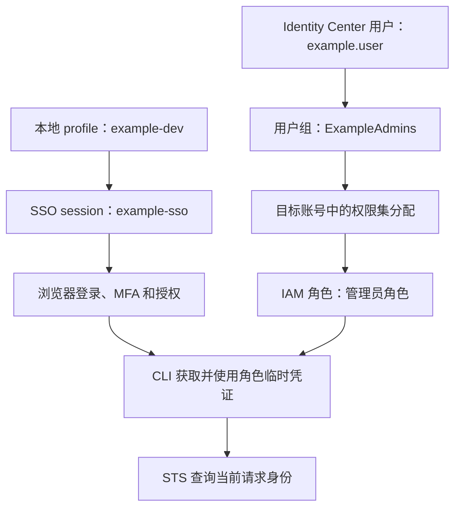

# aws-identity-clisso-001: AWS CLI：通过 IAM Identity Center 配置 SSO 并验证身份

## Concepts

### 1. 用户、用户组、权限集与角色

这套流程使用 **IAM Identity Center 用户**。它与 root、IAM 用户是不同类型的身份。

| 概念 | 通用示例 | 作用 |
|---|---|---|
| 用户 | `example.user` | 登录时确认“你是谁” |
| 用户组 | `ExampleAdmins` | 集中管理一组用户的访问权限 |
| AWS 账号 | 目标 AWS 账号 | 确定可以访问哪个账号 |
| 权限集 | `AdministratorAccess` | 定义分配到该账号的权限 |
| IAM 角色 | `AWSReservedSSO_AdministratorAccess_…` | CLI 实际使用其临时凭证执行请求 |

**创建用户并不会自动赋予 AWS 资源权限。** 还需要将用户或所属组与目标 AWS 账号、权限集关联。组名 `ExampleAdmins` 本身也没有赋权效果，权限来自分配。

示例中的授权关系是：

- 用户 `example.user` 属于 `ExampleAdmins` 组。
- `ExampleAdmins` 组在目标账号中获分配 `AdministratorAccess`。
- 因此可以通过该用户登录，选择对应账号和管理员角色。

### 2. Profile 与 SSO session

**Profile 是 AWS CLI 的本地配置名称，不是云端用户或角色。**

```bash
aws configure sso --profile example-dev
```

| 命令部分 | 含义 |
|---|---|
| `aws` | 运行 AWS CLI |
| `configure sso` | 配置 IAM Identity Center 登录方式 |
| `--profile example-dev` | 将配置命名为 `example-dev` |

两份配置分别承担不同职责：

- **SSO session `example-sso`**：保存登录入口、SSO 区域等登录配置，可供多个 profile 共用。
- **Profile `example-dev`**：关联该 session、目标账号、角色及默认资源区域。

Profile 不保存“永远有效的管理员权限”，也不会创建新权限。它告诉 CLI 去哪里登录，以及登录后使用哪个账号和角色。

### 3. SSO 登录与临时凭证

```bash
aws sso login --profile example-dev
```

这条命令通过浏览器完成用户登录、MFA 和授权，建立供 CLI 使用的 SSO 会话。

随后执行 AWS 命令时，CLI 获取并使用所选角色的临时凭证。用户不需要手动复制 Access key、Secret key 和 Session token。

**关闭终端不会自动退出 SSO。** 本地缓存可以供新终端继续使用；SSO 会话失效、无法继续刷新时，再执行登录命令。

### 4. STS 身份查询

```bash
aws sts get-caller-identity --profile example-dev
```

含义是：

> 使用 `example-dev` 对应的凭证，请 AWS 返回当前请求者的身份。

它返回：

| 字段 | 含义 |
|---|---|
| `Account` | 请求所属的 AWS 账号 |
| `Arn` | 当前使用的用户或角色身份 |
| `UserId` | 请求者身份标识 |

**这条命令查询身份，不返回权限令牌。** 成功说明当前请求的凭证有效，并允许我们检查是否使用了预期账号和角色；它不能证明所有服务的操作权限都已通过验证。

## Concept Relationships

整个流程分为云端授权、本地配置、登录和验证四部分：



云端分配决定**你被允许做什么**；本地 profile 决定**CLI 选择哪套配置**；SSO 登录证明**你是谁**；临时凭证使 CLI 能够发起经过认证的 AWS 请求。

浏览器控制台和终端 CLI 的登录状态分别管理。例如，浏览器以 root 登录时，CLI 仍可通过 SSO profile 使用管理员角色。配置 CLI 不会自动改变浏览器中的身份。

## 完整操作示例

### 第一步：准备云端用户与授权

从零配置时：

1. 在 IAM Identity Center 创建用户。
2. 创建用户组，并将用户加入组。
3. 在 **AWS accounts** 选择目标账号。
4. 将该组与所需权限集分配到账号。

如果这些配置已经存在，检查并复用即可，无需重复创建用户或分配权限。

### 第二步：创建本地 SSO profile

```bash
aws configure sso --profile example-dev
```

示例填写值：

| 提示 | 输入 |
|---|---|
| SSO session name | `example-sso` |
| SSO start URL | Dashboard 中的 Start URL 或 Issuer URL |
| SSO region | `ap-southeast-2` |
| SSO registration scopes | `sso:account:access` |
| AWS 账号 | 目标 AWS 账号 |
| Role | `AdministratorAccess` |
| Default client Region | `ap-southeast-2` |
| Output format | `json` |

SSO session name 需要填写；留空会进入 legacy 配置方式。

AWS CLI 从 `2.22.0` 起支持在 Start URL 提示中填写 Issuer URL。两个区域字段含义不同：**SSO region 是登录服务所在区域，Default client Region 是资源操作的默认区域**；本例恰好都为悉尼。

### 第三步：后续登录

```bash
aws sso login --profile example-dev
```

首次配置过程中已经完成浏览器登录时，无需立即重复登录。

### 第四步：验证当前身份

```bash
aws sts get-caller-identity --profile example-dev
```

以下为示意响应，不代表实际执行结果：

```json
{
  "UserId": "...",
  "Account": "<account-id>",
  "Arn": "arn:aws:sts::<account-id>:assumed-role/AWSReservedSSO_AdministratorAccess_<suffix>/<session-name>"
}
```

检查账号是否正确、ARN 是否为预期角色，然后再进入具体服务操作。

## Understanding

本节记录本次讨论中澄清的概念；身份名称已替换为通用示例：

- “创建 admin 用户”更准确地拆为：创建用户、加入组、在目标账号中分配权限集。
- `example-dev` 是本地别名，不是用户。
- SSO 登录不会改变已有的云端权限分配。
- `get-caller-identity` 用于身份验证，不是领取令牌的命令。
- 使用 SSO 管理员角色，不等于使用 root 身份。
- 重开终端通常不需要重新登录。

## References

整理时直接查阅的 AWS 官方文档（2026-10-28）：

- [配置 AWS CLI 的 IAM Identity Center 认证](https://docs.aws.amazon.com/cli/latest/userguide/cli-configure-sso.html)：配置向导、SSO session、Issuer URL、登录与命令执行。
- [向 AWS 账号分配用户或用户组访问权限](https://docs.aws.amazon.com/singlesignon/latest/userguide/assignusers.html)：用户组、目标账号和权限集的分配关系。
- [STS get-caller-identity 命令](https://docs.aws.amazon.com/cli/latest/reference/sts/get-caller-identity.html)：身份查询、命令参数及响应字段。


说明：本文中的用户名、组名、profile 和 session 名称均为通用示例，账号 ID 与会话标识使用占位符；未包含真实账号标识、登录入口、凭证或截图。管理员权限集仅用于解释本流程，不意味着所有用途都需要管理员权限。
