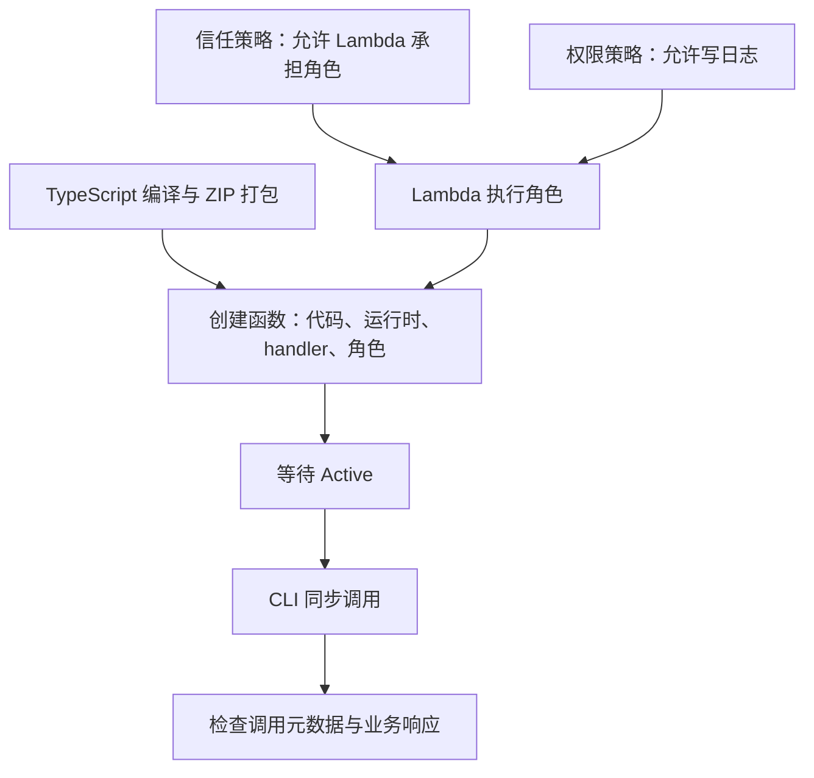

# aws-lambda-clideploy-001: 从 STS AssumeRole 到使用 AWS CLI 部署和调用 Lambda

## Concepts

### 1. STS AssumeRole：取得角色临时凭证

STS（Security Token Service）提供临时安全凭证。AssumeRole 表示承担一个 IAM 角色，取得代表该角色会话的临时凭证，包括 Access key ID、Secret access key 和 Session token。

必须区分两件事：

- 是否允许承担角色：由信任关系以及适用的调用方授权等条件决定。
- 承担角色后能做什么：由角色权限和其他适用的权限限制决定。

因此，不能说“AssumeRole 得到的凭证没有权限”，也不能说“允许 AssumeRole 就拥有日志或数据库权限”。准确说法是：凭证代表角色会话，AWS 根据相关策略判断每次请求能否执行。会话策略还可以进一步限制角色会话的权限。

在本练习中，Lambda 服务自动承担执行角色。业务代码不需要主动调用 STS 来承担自己的执行角色，也不需要把任何临时凭证写入代码。

### 2. 信任策略与权限策略

| 配置 | 回答的问题 | 本例 |
|---|---|---|
| 角色信任策略 | 谁可以承担这个角色？ | 允许 lambda.amazonaws.com 执行 sts:AssumeRole |
| 角色权限策略 | 使用角色后可以执行什么操作？ | AWSLambdaBasicExecutionRole 允许写入 CloudWatch Logs |
| 创建函数时的 --role | 该函数使用哪个执行角色？ | 指定此前创建的角色 ARN |

信任策略中的 Principal 是 Lambda 服务，而不是本地开发者。日志策略是附加在执行角色上的授权，不能用它代替信任策略。

仅配置本例的信任策略，不会因此获得日志或 DynamoDB 操作权限。加上日志策略后，可执行对应日志操作；以后访问数据库还需单独授权。

### 3. 部署身份、执行身份与调用权限

| 场景 | 身份或权限 |
|---|---|
| 开发者创建角色、部署函数、发起 CLI 调用 | 本地 profile 选择的开发者身份 |
| Lambda 运行时访问 AWS 服务 | 函数的执行角色 |
| 调用者是否能调用函数 | 调用者的 lambda:InvokeFunction 等适用授权 |

开发者拥有管理员权限，不意味着函数继承管理员权限。执行角色允许 Lambda 写日志，也不意味着任意人都能调用该函数。

### 4. TypeScript 编译、ZIP 与 handler

本例使用 tsc 编译，将 src/business/get-order.ts 输出为 dist/business/get-order.js。这里 tsconfig.json 配置了 rootDir、outDir，且没有启用 noEmit。

执行 npm run build 后，将 JavaScript 文件放到 ZIP 根目录：

- 本地输出：dist/business/get-order.js
- ZIP 内路径：get-order.js
- Lambda handler：get-order.handler

handler 配置由“模块路径（不含扩展名）.导出函数名”组成。Lambda 据此加载模块并调用导出的 handler。

本例函数没有运行时第三方依赖，且已用 require 成功加载编译输出，因此可以用此单文件 CommonJS 包。以后增加运行时依赖或改用 ESM，需重新核对打包内容和模块格式，不能直接沿用单文件打包假设。

直接运行该 JavaScript 文件没有输出，是因为文件只导出函数，没有主动调用它。

### 5. 调用成功与业务成功

aws lambda invoke 默认同步调用。CLI 输出调用元数据，函数返回的业务对象写入指定响应文件。

需要检查三层结果：

| 层次 | 检查项 | 含义 |
|---|---|---|
| 调用接口 | StatusCode | 例如同步调用返回 200；不能单独证明函数无异常 |
| 函数执行 | 是否有 FunctionError | 有该字段时，检查响应中的执行错误 |
| 业务结果 | 响应中的 ok、error 等 | 函数可以正常执行，但业务结果是 NOT_FOUND |

例如，订单不存在时，本例返回 ok: false 和 NOT_FOUND。这是业务错误，并非未捕获异常；仍可能没有 FunctionError。

## Concept Relationships

创建执行角色先解决身份与授权；编译打包提供可执行代码；create-function 将代码、运行时、入口和角色关联；函数就绪后才能验证真实云端调用。



运行期间，Lambda 服务自动承担执行角色，使用角色凭证执行获准的 AWS 操作。角色配置不是每次调用前由开发者重新执行的一组步骤。

## 完整操作示例

以下名称和账号均为通用示例或占位符；不是当前账号的真实配置。命令从项目根目录执行，假设已准备好有效的 example-dev profile 和示例业务代码。创建角色、附加策略和创建函数会修改云端资源；本节记录首次部署流程，不是可重复执行的完整部署脚本。

### 第一步：编写信任策略

```bash
mkdir -p infra

cat > infra/lambda-trust-policy.json <<'JSON'
{
  "Version": "2012-10-17",
  "Statement": [
    {
      "Effect": "Allow",
      "Principal": {
        "Service": "lambda.amazonaws.com"
      },
      "Action": "sts:AssumeRole"
    }
  ]
}
JSON
```

这里的 sts:AssumeRole 是信任策略中的授权动作。创建这个 JSON 文件本身不调用 STS，也不获取凭证。

### 第二步：创建执行角色

```bash
aws iam create-role \
  --role-name example-get-order-exec \
  --assume-role-policy-document file://infra/lambda-trust-policy.json \
  --description "Execution role for example order Lambda" \
  --profile example-dev \
  --query 'Role.Arn' \
  --output text
```

返回的 ARN 是角色标识，不是临时令牌。创建函数时会引用它。

### 第三步：附加并检查日志权限

```bash
aws iam attach-role-policy \
  --role-name example-get-order-exec \
  --policy-arn arn:aws:iam::aws:policy/service-role/AWSLambdaBasicExecutionRole \
  --profile example-dev

aws iam list-attached-role-policies \
  --role-name example-get-order-exec \
  --profile example-dev
```

AWSLambdaBasicExecutionRole 是 AWS 托管策略，包含：

- logs:CreateLogGroup：创建日志组。
- logs:CreateLogStream：创建日志流。
- logs:PutLogEvents：写入日志。

attach-role-policy 成功通常无输出，查询结果应包含该策略。它不授予数据库访问权限。

### 第四步：构建并检查部署包

```bash
function prepare_artifact() {
    npm run build || return
    mkdir -p artifacts || return
    rm -f artifacts/get-order.zip || return
    zip -j artifacts/get-order.zip dist/business/get-order.js || return
    unzip -l artifacts/get-order.zip
}

prepare_artifact
```

-j 去掉源文件目录层级。检查 ZIP 根目录中有 get-order.js。每一步的 || return 避免前一步失败后继续打包或误报成功；删除旧 ZIP 避免残留旧条目。

### 第五步：创建 Lambda

将下方 ACCOUNT_ID 占位符替换为目标账号 ID，角色名与前面保持一致。

```bash
aws lambda create-function \
  --function-name example-get-order \
  --runtime nodejs22.x \
  --handler get-order.handler \
  --role arn:aws:iam::ACCOUNT_ID:role/example-get-order-exec \
  --zip-file fileb://artifacts/get-order.zip \
  --timeout 5 \
  --memory-size 128 \
  --region ap-southeast-2 \
  --profile example-dev \
  --query '{Name:FunctionName,State:State,Runtime:Runtime,Handler:Handler}'
```

| 参数 | 作用 |
|---|---|
| --function-name | 云端函数名称 |
| --runtime | 执行 JavaScript 的 Node.js 运行时 |
| --handler | ZIP 内模块路径和导出函数名 |
| --role | 运行时使用的执行角色 ARN |
| --zip-file fileb://... | 将 ZIP 文件按二进制上传 |
| --timeout 5 | 函数执行超时秒数 |
| --memory-size 128 | 分配内存，单位 MB |
| --region | 函数部署区域 |
| --profile | 开发者发起部署请求使用的本地身份配置 |
| --query | 筛选 CLI 展示字段，不改变创建行为 |

### 第六步：等待就绪

创建响应中的 Pending 表示仍在初始化，不代表部署失败。

```bash
aws lambda wait function-active-v2 \
  --function-name example-get-order \
  --region ap-southeast-2 \
  --profile example-dev
```

成功通常没有输出；失败时应先排查，不继续假设函数已就绪。

### 第七步：调用并读取业务响应

```bash
aws lambda invoke \
  --function-name example-get-order \
  --cli-binary-format raw-in-base64-out \
  --payload '{"order_id":"ORDER-001"}' \
  --region ap-southeast-2 \
  --profile example-dev \
  artifacts/get-order-response.json

cat artifacts/get-order-response.json
```

raw-in-base64-out 让 CLI 接受直接填写的 JSON payload。响应文件是业务输出，不是临时凭证。

本次实际练习已观察到的结果（资源名称已省略）：

```json
{
  "StatusCode": 200,
  "ExecutedVersion": "$LATEST"
}
```

```json
{
  "ok": true,
  "order": {
    "order_id": "ORDER-001",
    "status": "pending",
    "amount": 99,
    "currency": "AUD"
  }
}
```

这组元数据与业务输出共同证明：云端函数已执行并返回预期模拟订单。它没有验证数据库查询或 MCP 协议链路。

## Understanding

本次实操与讨论中形成的区分：

- 用户提出“AssumeRole 只是获取凭证，但是没有权限”的疑问。讨论中修正为：AssumeRole 本身不授予业务动作，拿到的角色会话凭证按角色授权使用；不是凭证天然没有权限。
- 信任策略控制谁可以承担角色；附加权限策略控制承担后能做什么。
- 开发者使用的 SSO 身份与 Lambda 的执行身份分别管理。
- 实际操作依次完成了角色创建、策略附加和查询、编译打包、函数创建、等待就绪、同步调用和响应检查。
- 本地已验证正常订单、订单不存在和空参数三条路径；云端已验证正常订单路径。不能把本地错误分支验证写成已完成云端验证。

## Open Questions

- 云端 NOT_FOUND 和 INVALID_INPUT 分支尚未提供执行结果。
- 日志策略已确认附加；尚未展示 CloudWatch 日志读取结果。
- 当前只完成业务 Lambda，MCP 入口和数据库连接不在本次完成范围内。

## References

整理时直接查阅的 AWS 官方文档（2026-10-29）：

- [STS AssumeRole](https://docs.aws.amazon.com/STS/latest/APIReference/API_AssumeRole.html)：临时凭证、角色信任关系和会话权限。
- [Lambda execution role](https://docs.aws.amazon.com/lambda/latest/dg/lambda-intro-execution-role.html)：Lambda 自动承担执行角色、信任策略、CLI 创建与权限附加。
- [AWSLambdaBasicExecutionRole](https://docs.aws.amazon.com/aws-managed-policy/latest/reference/AWSLambdaBasicExecutionRole.html)：日志权限与策略 JSON。
- [lambda create-function](https://docs.aws.amazon.com/cli/latest/reference/lambda/create-function.html)：部署包、执行角色、运行时、handler 和函数状态。
- [lambda invoke](https://docs.aws.amazon.com/cli/latest/reference/lambda/invoke.html)：同步调用、payload、响应文件及 FunctionError。

本次会话还实际查阅过的来源：

- [TypeScript Lambda](https://docs.aws.amazon.com/lambda/latest/dg/lambda-typescript.html)：TypeScript 编译和类型检查。
- [TypeScript ZIP deployment](https://docs.aws.amazon.com/lambda/latest/dg/typescript-package.html)：TypeScript 部署包背景；文中 esbuild 示例与本次实际使用 tsc 的步骤需区分。

会话证据：用户提供的本地类型配置、脚本、打包列表、角色策略查询、创建函数响应和调用输出。本文已脱敏，不包含真实账号、用户名、SSO 入口、凭证或截图。相关前置笔记：[AWS CLI SSO 身份配置](aws-identity-clisso-001.md)。
